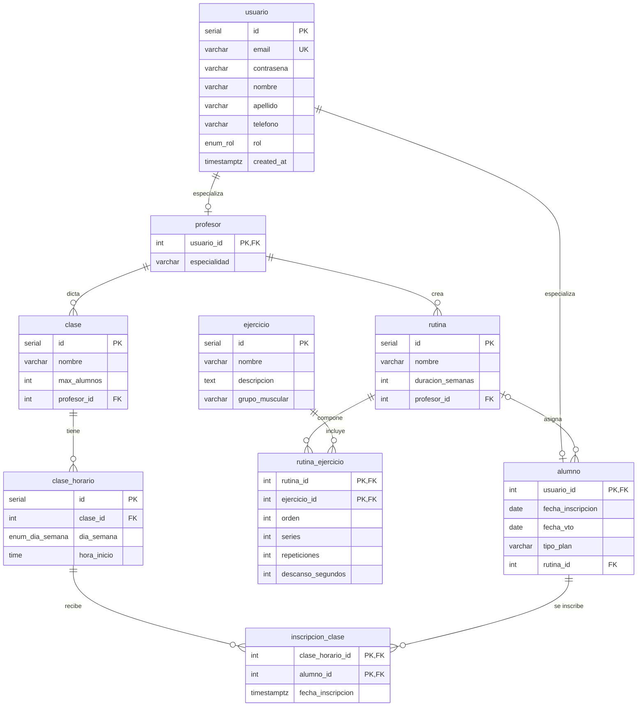

# gym-website

Página web para gimnasios. El objetivo es digitalizar las rutinas, agilizar su actualización y canalizar la inscripción a clases e información en la aplicación. A su vez, mejorar la cercanía con el cliente y su experiencia.

Esta rama (`tp5`) expone una API REST y páginas HTML renderizadas en el servidor con templ. La lógica de negocio persiste en PostgreSQL mediante sqlc. Incluye los tests de integración y `requests.hurl`.

## Cómo ejecutar

Requisitos: Go, Docker y Docker Compose. Para `make test-api`, también Hurl. Los puertos `5432` y `8080` deben estar libres.

Después de clonar, este comando prepara el proyecto, levanta la base y ejecuta la aplicación en `http://localhost:8080`:

```bash
git clone <url-del-repo>
cd <nombre-del-repo>
git checkout tp5
make run-app
```

`make run-app` hace, en orden:

1. Instala sqlc y templ si no están, genera `db/sqlc/` y las vistas con `templ generate`, y compila `main.go`
2. Borra contenedores y volúmenes previos
3. Levanta Postgres y espera a que acepte conexiones (healthcheck y una espera adicional)
4. Ejecuta la aplicación
5. Al salir el proceso, también con Ctrl+C, borra contenedores y volúmenes

Hacen falta Go, Docker y Docker Compose, con los puertos `5432` y `8080` libres. Si el `5432` está ocupado, hay que liberarlo: `make run-app` no usa un Postgres ajeno. Para cortar el servidor, Ctrl+C en esa terminal.

 `make test` ejecuta los tests de integración de Go. `make test-api` prueba la API y requiere Hurl.

## Persistencia

Los datos viven en **PostgreSQL 15** (`postgres:15-alpine`), definido en `docker-compose.yml`.

- Base: `tp2_db`
- Usuario / contraseña: `postgres` / `postgres`
- Puerto: `5432`
- Volumen: `postgres_data`

El esquema está en `db/migration/*.up.sql` (enums → tablas). Compose monta `./db/migration` en `/opt/sql/migration` y ejecuta `init.sh`, que aplica los `.up.sql` en orden numérico y luego `funciones.sql` y `procedure.sql`. Postgres lo corre **solo la primera vez** que se crea el volumen. Por eso el Makefile usa `docker compose down -v` antes y después: cada corrida arranca con el schema limpio.

Las consultas SQL están en `db/queries/`. `sqlc.yaml` las traduce a Go en `db/sqlc/` (paquete `db`). Ese código no se edita a mano.

Los tests se conectan con el driver `github.com/lib/pq` usando:

`host=localhost port=5432 user=postgres password=postgres dbname=tp2_db sslmode=disable`

`main.go` abre el mismo pool (o `DATABASE_URL` si está definida), hace `Ping` y pasa `*db.Queries` a los servicios. Si Postgres no está arriba, la app no arranca.

`make run-app`, `make test` y `make test-api` borran el volumen y dejan que `init.sh` aplique el schema completo. `make up` y `make down` conservan `postgres_data`. Para aplicar un archivo nuevo sobre esa base: `make migrate FILE=db/migration/XXXX_nombre.up.sql`.

### Modelo

`usuario` es la identidad (email, contraseña, nombre, apellido, teléfono, `rol`). `alumno` y `profesor` la especializan 1:1 (`usuario_id` es PK y FK).

`ON DELETE CASCADE`: `usuario` borra su `alumno` o `profesor`; `rutina` borra sus filas de `rutina_ejercicio`; `clase` borra sus `clase_horario` y esas filas borran `inscripcion_clase`; `alumno` borra sus inscripciones.

Sin cascade, el `DELETE` del padre falla si hay hijos: un `ejercicio` que está en `rutina_ejercicio`, una `rutina` referenciada por `alumno.rutina_id`, y un `profesor` referenciado por `rutina.profesor_id` o `clase.profesor_id`. En la API JSON esa falla es `400`; en los formularios, `409`.



| Tabla | Qué guarda |
|---|---|
| `usuario` | Datos personales y rol (`alumno` / `profesor`) |
| `alumno` | Fecha de inscripción, vencimiento, tipo de plan, rutina asignada |
| `profesor` | Especialidad |
| `ejercicio` | Nombre, descripción, grupo muscular |
| `rutina` | Nombre, duración en semanas, profesor |
| `rutina_ejercicio` | Ejercicios de una rutina (orden, series, reps, descanso) |
| `clase` | Nombre, cupo, profesor |
| `clase_horario` | Día de la semana y hora |
| `inscripcion_clase` | Alumno inscripto a un horario |

Consultas en `db/queries/`: alta, lectura por id, actualización y baja de `usuario` (sin listado); CRUD de ejercicio, rutina y clase; alta, ficha, listado y actualización de profesor y de alumno. La baja de alumno y de profesor es `DeleteUsuario`. Horarios e inscripciones tienen alta, listado y baja. Los joins de ejercicios de una rutina, clases de un profesor y profesores de un día están en `db/queries/multitabla.sql` y en `test/`; solo el de ejercicios de una rutina tiene ruta HTTP (`GET /api/rutinas/{id}/ejercicios`).

## Tests

Paquete `test` en `test/`. Prueban la persistencia contra la base real: usuario, alumno, profesor, ejercicio, rutina, clase, inscripciones y consultas multitabla. `make test` levanta un volumen nuevo y, al terminar, borra contenedores y volúmenes. **No** arranca el servidor HTTP; las pruebas de la API se corren por separado con `make test-api` (ver **API REST**).

## API REST

Capa onion: handler HTTP → servicio → puerto. `*db.Queries` implementa los puertos. La API cubre todas las entidades del modelo.

La aplicación se abre con `make run-app`, descrito en «Cómo ejecutar», y queda en `http://localhost:8080`.

Las páginas de gestión se renderizan del lado del servidor con `templ`. `/` es el listado de alumnos. `/profesores`, `/ejercicios`, `/rutinas` y `/clases` muestran sus registros y el formulario de alta. Los formularios usan POST tradicional y el servidor redirige con HTTP 303 (Post/Redirect/Get).

| Método | Ruta | Qué hace |
|---|---|---|
| `GET` | `/` | Listado y alta de alumnos |
| `POST` | `/alumnos` | Alta; 303 hacia `/` |
| `GET` | `/alumnos/{id}/editar` | Formulario de edición |
| `POST` | `/alumnos/{id}` | Guardar plan, vencimiento y rutina; 303 hacia `/` |
| `POST` | `/alumnos/{id}/eliminar` | Baja; 303 hacia `/` |
| `GET` | `/profesores` | Listado y alta |
| `POST` | `/profesores` | Alta; 303 hacia `/profesores` |
| `GET` | `/profesores/{id}/editar` | Formulario de edición |
| `POST` | `/profesores/{id}` | Guardar especialidad; 303 hacia `/profesores` |
| `POST` | `/profesores/{id}/eliminar` | Baja; 303 hacia `/profesores` |
| `GET` | `/ejercicios` | Listado y alta |
| `POST` | `/ejercicios` | Alta; 303 hacia `/ejercicios` |
| `GET` | `/ejercicios/{id}/editar` | Formulario de edición |
| `POST` | `/ejercicios/{id}` | Guardar; 303 hacia `/ejercicios` |
| `POST` | `/ejercicios/{id}/eliminar` | Baja; 303 hacia `/ejercicios` |
| `GET` | `/rutinas` | Listado y alta |
| `POST` | `/rutinas` | Alta; exige al menos un ejercicio; 303 hacia `/rutinas` |
| `GET` | `/rutinas/{id}/editar` | Edición, con ejercicios ya asociados preseleccionados |
| `POST` | `/rutinas/{id}` | Guardar atributos, profesor y ejercicios; 303 hacia `/rutinas` |
| `POST` | `/rutinas/{id}/eliminar` | Baja; 303 hacia `/rutinas` |
| `GET` | `/clases` | Listado y alta |
| `POST` | `/clases` | Alta; 303 hacia `/clases` |
| `GET` | `/clases/{id}/editar` | Formulario de edición |
| `POST` | `/clases/{id}` | Guardar; 303 hacia `/clases` |
| `POST` | `/clases/{id}/eliminar` | Baja; 303 hacia `/clases` |
| `GET` | `/static/` | Archivos de `static/` (`/static/styles.css`) |

Las cinco tablas permiten editar y borrar filas:
alumnos permite cambiar plan, vencimiento y rutina asignada; profesores,
especialidad; ejercicios, sus datos del catálogo; y rutinas/clases, sus atributos y
profesor responsable. Rutinas y clases requieren seleccionar un profesor existente;
un ejercicio que ya forma parte de una rutina no se puede borrar. Tampoco una rutina que un alumno tenga asignada, ni un profesor que todavía tenga rutinas o clases. Borrar una clase sí borra sus horarios y las inscripciones de esos horarios. Las vistas fuente
están en `views/*.templ` y el CSS se sirve desde `static/`.

El formulario de rutinas permite seleccionar varios ejercicios del catálogo. Al
editar una rutina, los ejercicios asociados aparecen preseleccionados; guardar los
cambios agrega los nuevos seleccionados y quita los desmarcados.

El nombre visible de la aplicación es **Gym Web**.

### Organización de los handlers web

La separación entre los handlers de alumnos/profesores y los del resto de los
catálogos es intencional; no indica que falten operaciones. Alumnos y profesores
representan altas de personas: ambos crean primero una identidad de usuario
(nombre, apellido, correo y contraseña) y luego sus datos específicos. Por eso
tienen handlers de listado y creación propios en `internal/web/handler.go`.

Ejercicios, rutinas y clases no crean usuarios. Sus rutas delegan en operaciones
comunes de catálogo (`showCatalog`, `editCatalog`, `saveCatalog` y
`deleteCatalog`), implementadas en `internal/web/catalog_pages.go` y
`internal/web/catalog_forms.go`. Los métodos por entidad de `catalog.go` son
adaptadores del router: eligen el catálogo y si la operación es alta, edición o
baja.

`renderFormError` está limitado a las altas de alumnos y profesores porque solo
lo invocan `CreateAlumno` y `CreateProfesor`. Si esos formularios fallan, vuelve
a cargar la tabla correspondiente y conserva los campos enviados para que la
persona pueda corregirlos; la contraseña no se conserva. Los errores de alta,
edición o baja de ejercicios, rutinas y clases —y los de edición/baja de alumnos
y profesores— siguen otro recorrido: `saveCatalog` o `deleteCatalog` llama a
`showCatalog`, que reconstruye la página con sus valores y el mensaje de error.

Esta distinción simplifica el flujo actual al mantener juntas las altas de
identidad y reutilizar el mismo flujo para los catálogos restantes. No es una
limitación del servidor ni un requisito de Go: podría refactorizarse a un flujo
único, pero habría que conservar las diferencias de campos y servicios para no
perder validación ni los valores del formulario al mostrar errores.

El flujo de edición y baja es server-side: editar abre una página GET y
guarda con POST; eliminar también se solicita con POST porque los formularios HTML
nativos solo soportan GET y POST. No se usa HTMX ni se modifica el DOM desde
JavaScript para estas operaciones.

La API JSON de TP3 se conserva en `/api/...` para clientes existentes y para sus pruebas; la interfaz web ya no la consume desde JavaScript. Los endpoints son los mismos que se especifican en la rama `tp3`. Se dejan como ambiente de prueba: se pueden probar con curl o Postman, sin pasar por las páginas HTML.

### Prueba automática (requests.hurl)

El archivo `requests.hurl` recorre el CRUD completo de todas las entidades, casos
de error y los `DELETE`, encadenando los IDs reales que devuelve la API con las
capacidades nativas de Hurl (`[Captures]` y `[Asserts]`).

`make test-api` hace el ciclo completo: sqlc y compilación, baja contenedores y volúmenes, levanta Postgres, arranca el servidor, corre `requests.hurl`, mata el servidor y vuelve a borrar contenedores y volúmenes.

```bash
make test-api
```

Para depurar una petición con el servidor ya levantado (`make up` y `make run` en otra terminal), se puede usar `hurl --test requests.hurl`.

La URL base se define en `requests.hurl` (variable `base_url`, por defecto
`http://localhost:8080`). Como las variables de `[Options]` tienen la máxima
prioridad en Hurl, para apuntar a otro host se edita esa línea en el archivo.

### Interfaz web (SSR con templ)

La interfaz de administración se genera en el servidor con componentes `templ`.
`make build` ejecuta sqlc, genera las vistas con `templ generate` y compila el
servidor. La aplicación se abre con `make run-app`, descrito en «Cómo ejecutar», y queda en `http://localhost:8080`.

El listado y el formulario se componen en `views/layout.templ`,
`views/entity_list.templ` y `views/entity_form.templ`. La interfaz permite
registrar y listar alumnos, profesores, ejercicios, rutinas y clases; también
editar y eliminar sus registros. Los formularios usan el patrón
Post/Redirect/Get y las páginas se vuelven a renderizar en el servidor. No hay
JavaScript de cliente en estas páginas. La base PostgreSQL debe estar activa.
La integración sin recarga mediante HTMX corresponde al TP6 y se deja para una
etapa posterior.

### Ejemplos sueltos

```bash
curl -s http://localhost:8080/api/ejercicios
curl -s -X POST http://localhost:8080/api/ejercicios \
  -H 'Content-Type: application/json' \
  -d '{"nombre":"sentadilla","descripcion":"barra","grupo_muscular":"piernas"}'
curl -s -X POST http://localhost:8080/api/alumnos \
  -H 'Content-Type: application/json' \
  -d '{"email":"a@example.com","contrasena":"secret123","nombre":"Ana","apellido":"Lopez","fecha_inscripcion":"2026-09-10","tipo_plan":"mensual"}'
```

Esos `curl` pegan al servidor que dejó `make run-app`; al cortarlo se borran contenedores y volúmenes.

## Funcionalidades previstas del sistema

**Usuario profesor**

- Carga rutinas con ejercicios
- Asigna las rutinas a los alumnos
- Gestionar clases (pack de clases)
- Dashboard con métricas por persona (pesos, concurrencia, ritmos)

**Usuario alumno**

- Ve la rutina que le fue asignada
- Accede a los ejercicios (imágenes/videos)
- Ver calendario e inscribirse a una clase

En este TP la persistencia, los tests y la API cubren el modelo completo (usuario vía alumno/profesor, ejercicio, rutina, rutina_ejercicio, clase, clase_horario e inscripción).

## Requisitos / versiones

- Go `1.26.5`
- sqlc `v1.31.1`
- templ `v0.3.1100`
- PostgreSQL `15-alpine` (imagen Docker)
- Docker Compose `3.8`
- Hurl `8.0.1` (para `make test-api` / `requests.hurl`)
- `github.com/lib/pq` `v1.12.3`
- Variable `PORT` (por defecto `8080`) y `DATABASE_URL` (si no está, vale el connection string de arriba)

## Estructura de capas

- `internal/handler`: capa HTTP. Parsea JSON/URL, llama al servicio y traduce los
  errores de dominio a códigos de estado (`json.go`). No conoce SQL.
- `internal/web`: páginas HTML. Formularios, catálogos y redirección 303. Tampoco conoce SQL.
- `views/`: componentes templ (`layout.templ`, `entity_list.templ`, `entity_form.templ`).
- `internal/service`: lógica de negocio y validaciones. Define los tipos del
  dominio (`*_types.go`), los servicios (CRUD) y los **puertos** (`ports.go`).
- `db/sqlc`: código generado por sqlc (paquete `db`). `*db.Queries` implementa
  los puertos sin adaptador. `db/sqlc/alumno.go` y `db/sqlc/profesor.go` son
  archivos escritos a mano para el alta compuesta usuario + alumno/profesor.

Petición JSON: `internal/handler → service → puerto → *db.Queries → PostgreSQL`.

Petición HTML: `internal/web → service → puerto → *db.Queries → PostgreSQL`.

Si `make run-app` no puede publicar el puerto `5432`, ese puerto está ocupado y hay que liberarlo antes de volver a ejecutarlo.
