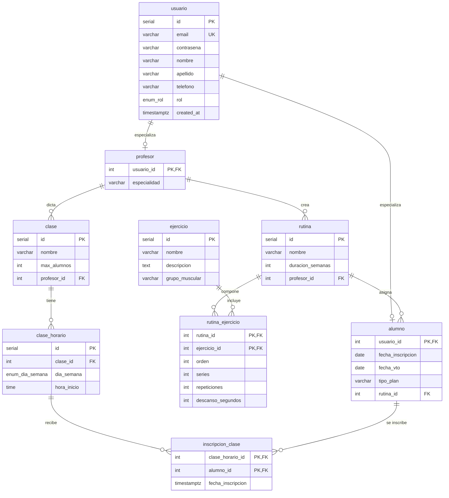

# gym-website

Página web para gimnasios. El objetivo es digitalizar las rutinas, agilizar su actualización y canalizar la inscripción a clases e información en la aplicación. A su vez, mejorar la cercanía con el cliente y su experiencia.

Este repositorio corresponde al TP3: una API REST que expone la lógica de negocio sobre la persistencia en PostgreSQL generada con sqlc. Incluye además los tests de integración del TP2.

## Cómo ejecutar

Requisitos: Go, Docker y Docker Compose. Para `make test-api`, también Hurl. Los puertos `5432` y `8080` deben estar libres.

```bash
git clone <url-del-repo>
cd <nombre-del-repo>
git checkout tp3
make test
```

`make test` ejecuta únicamente los tests de integración de Go (`go test ./test/...`). No levanta el servidor ni ejecuta las pruebas de la API (`make test-api`).

`make test` hace, en orden:

1. Instala sqlc (si hace falta) y genera el código en `db/sqlc/`
2. Compila `main.go`
3. Baja contenedores y volúmenes previos
4. Levanta Postgres y espera a que esté listo (healthcheck)
5. Corre los tests (`go test ./test/...`)
6. Baja contenedores y volúmenes

## Persistencia

Los datos viven en **PostgreSQL 15** (`postgres:15-alpine`), definido en `docker-compose.yml`.

- Base: `tp2_db`
- Usuario / contraseña: `postgres` / `postgres`
- Puerto: `5432`
- Volumen: `postgres_data`

El esquema está en `db/migration/*.up.sql` (enums → tablas). Compose monta `./db/migration` en `/opt/sql/migration` y ejecuta `init.sh`, que aplica los `.up.sql` en orden numérico y luego `funciones.sql` y `procedure.sql`. Postgres lo corre **solo la primera vez** que se crea el volumen. Por eso el Makefile usa `docker compose down -v` antes y después: cada corrida arranca con el schema limpio.

Las consultas SQL están en `db/queries/`. `sqlc.yaml` las traduce a Go en `db/sqlc/` (paquete `db`). Ese código no se edita a mano.

Los tests se conectan con el driver `github.com/lib/pq` usando:

`host=localhost port=5432 user=postgres password=postgres dbname=tp2_db sslmode=disable`

`main.go` abre el mismo pool (o `DATABASE_URL` si está definida), hace `Ping` y pasa `*db.Queries` a los servicios. Si Postgres no está arriba, la app no arranca.

No hay migraciones incrementales: un solo schema al init del contenedor.

### Modelo

`usuario` es la identidad (email, contraseña, nombre, apellido, teléfono, `rol`). `alumno` y `profesor` la especializan 1:1 (`usuario_id` es PK y FK). Borrar un usuario, por `ON DELETE CASCADE`, borra el alumno o profesor asociado.



| Tabla | Qué guarda |
|---|---|
| `usuario` | Datos personales y rol (`alumno` / `profesor`) |
| `alumno` | Fecha de inscripción, vencimiento, tipo de plan, rutina asignada |
| `profesor` | Especialidad |
| `ejercicio` | Nombre, descripción, grupo muscular |
| `rutina` | Nombre, duración en semanas, profesor |
| `rutina_ejercicio` | Ejercicios de una rutina (orden, series, reps, descanso) |
| `clase` | Nombre, cupo, profesor |
| `clase_horario` | Día de la semana y hora |
| `inscripcion_clase` | Alumno inscripto a un horario |

Consultas cubiertas: CRUD de usuario, ejercicio, profesor, rutina y clase; alta/listado/update de alumno (join con usuario); inscripciones; joins (ejercicios de una rutina, clases de un profesor, profesores de un día).

## Tests

Paquete `testing` en `test/`. Prueban la persistencia contra la base real: usuario, alumno, profesor, ejercicio, rutina, clase, inscripciones y consultas multitabla. Cada `make test` deja la DB en un estado fresco. `make test` **no** arranca el servidor HTTP; las pruebas de la API se corren por separado con `make test-api` (ver **API REST**).

## API REST

Capa onion: handler HTTP → servicio → puerto. `*db.Queries` implementa los puertos. La API cubre todas las entidades del modelo.

Levantar la base y el servidor (en dos terminales, o la base primero):

```bash
make up
make run
```

`GET /` sigue sirviendo `static/`. JSON en `/api/...`:

| Método | Ruta | Qué hace |
|---|---|---|
| `POST` | `/api/ejercicios` | Crear |
| `GET` | `/api/ejercicios` | Listar |
| `GET` | `/api/ejercicios/{id}` | Obtener (404 si no existe) |
| `PUT` | `/api/ejercicios/{id}` | Actualizar |
| `DELETE` | `/api/ejercicios/{id}` | Borrar (204) |
| `POST` | `/api/alumnos` | Alta usuario+alumno (`CreateAlumno`) |
| `GET` | `/api/alumnos` | Listar (join con usuario) |
| `GET` | `/api/alumnos/{id}` | Ficha |
| `PUT` | `/api/alumnos/{id}` | Plan / vencimiento / rutina |
| `DELETE` | `/api/alumnos/{id}` | Borrar usuario (cascade al alumno) |
| `POST` | `/api/profesores` | Alta usuario+profesor (`CreateProfesor`) |
| `GET` | `/api/profesores` | Listar (join con usuario) |
| `GET` | `/api/profesores/{id}` | Ficha |
| `PUT` | `/api/profesores/{id}` | Actualizar especialidad |
| `DELETE` | `/api/profesores/{id}` | Borrar usuario (cascade al profesor) |
| `POST` | `/api/rutinas` | Crear |
| `GET` | `/api/rutinas` | Listar |
| `GET` | `/api/rutinas/{id}` | Obtener |
| `PUT` | `/api/rutinas/{id}` | Actualizar |
| `DELETE` | `/api/rutinas/{id}` | Borrar |
| `POST` | `/api/rutinas/{id}/ejercicios` | Agregar ejercicio a la rutina |
| `GET` | `/api/rutinas/{id}/ejercicios` | Listar ejercicios de la rutina |
| `PUT` | `/api/rutinas/{id}/ejercicios/{ejercicio_id}` | Editar orden/series/reps |
| `DELETE` | `/api/rutinas/{id}/ejercicios/{ejercicio_id}` | Quitar ejercicio |
| `POST` | `/api/clases` | Crear |
| `GET` | `/api/clases` | Listar |
| `GET` | `/api/clases/{id}` | Obtener |
| `PUT` | `/api/clases/{id}` | Actualizar |
| `DELETE` | `/api/clases/{id}` | Borrar |
| `POST` | `/api/clases/{id}/horarios` | Agregar horario a la clase |
| `GET` | `/api/clases/{id}/horarios` | Listar horarios de la clase |
| `GET` | `/api/horarios/{id}` | Obtener horario |
| `DELETE` | `/api/horarios/{id}` | Borrar horario |
| `POST` | `/api/horarios/{id}/inscripciones` | Inscribir alumno (valida cupo) |
| `GET` | `/api/horarios/{id}/inscripciones` | Listar inscriptos |
| `DELETE` | `/api/horarios/{id}/inscripciones/{alumno_id}` | Dar de baja |

Códigos de estado: `201` al crear, `204` al borrar, `200` al consultar/actualizar,
`400` datos inválidos o JSON malformado, `404` no encontrado, `409` conflicto
(duplicado o cupo completo), `500` error interno.

### Prueba automática (requests.hurl)

El archivo `requests.hurl` recorre el CRUD completo de todas las entidades, casos
de error y los `DELETE`, encadenando los IDs reales que devuelve la API con las
capacidades nativas de Hurl (`[Captures]` y `[Asserts]`).

`make test-api` hace el ciclo completo: sqlc y compilación, baja contenedores y volúmenes, levanta Postgres, arranca el servidor, corre `requests.hurl`, mata el servidor y vuelve a borrar contenedores y volúmenes.

```bash
make test-api
```

Para depurar una petición con el servidor ya levantado (`make up` y `make run` en otra terminal), se puede usar `hurl --test requests.hurl`.

La URL base se define en `requests.hurl` (variable `base_url`, por defecto
`http://localhost:8080`). Como las variables de `[Options]` tienen la máxima
prioridad en Hurl, para apuntar a otro host se edita esa línea en el archivo.

### Ejemplos sueltos

```bash
curl -s http://localhost:8080/api/ejercicios
curl -s -X POST http://localhost:8080/api/ejercicios \
  -H 'Content-Type: application/json' \
  -d '{"nombre":"sentadilla","descripcion":"barra","grupo_muscular":"piernas"}'
curl -s -X POST http://localhost:8080/api/alumnos \
  -H 'Content-Type: application/json' \
  -d '{"email":"a@example.com","contrasena":"secret123","nombre":"Ana","apellido":"Lopez","fecha_inscripcion":"2026-09-10","tipo_plan":"mensual"}'
```

Al terminar: `make down`.

## Funcionalidades previstas del sistema

**Usuario profesor**

- Carga rutinas con ejercicios
- Asigna las rutinas a los alumnos
- Gestionar clases (pack de clases)
- Dashboard con métricas por persona (pesos, concurrencia, ritmos)

**Usuario alumno**

- Ve la rutina que le fue asignada
- Accede a los ejercicios (imágenes/videos)
- Ver calendario e inscribirse a una clase

En este TP la persistencia, los tests y la API cubren el modelo completo (usuario vía alumno/profesor, ejercicio, rutina, rutina_ejercicio, clase, clase_horario e inscripción).

## Requisitos / versiones

- Go `1.26.5`
- sqlc `v1.31.1`
- PostgreSQL `15-alpine` (imagen Docker)
- Docker Compose `3.8`
- Hurl `8.0.1` (para `make test-api` / `requests.hurl`)
- `github.com/lib/pq` `v1.12.3`

## Estructura de capas

- `internal/handler`: capa HTTP. Parsea JSON/URL, llama al servicio y traduce los
  errores de dominio a códigos de estado (`json.go`). No conoce SQL.
- `internal/service`: lógica de negocio y validaciones. Define los tipos del
  dominio (`*_types.go`), los servicios (CRUD) y los **puertos** (`ports.go`).
- `db/sqlc`: código generado por sqlc (paquete `db`). `*db.Queries` implementa
  los puertos sin adaptador. `db/sqlc/alumno.go` y `db/sqlc/profesor.go` son
  archivos escritos a mano para el alta compuesta usuario + alumno/profesor.

Flujo de una petición: `handler → service → puerto (interface) → *db.Queries → PostgreSQL`.

Si `make up` falla porque el puerto `5432` ya está ocupado, alcanza con que esa
instancia tenga la base `tp2_db` y el schema; `make run` usa la misma cadena que
los tests. Al terminar: `make down` (solo si levantaste Compose en este paso).
