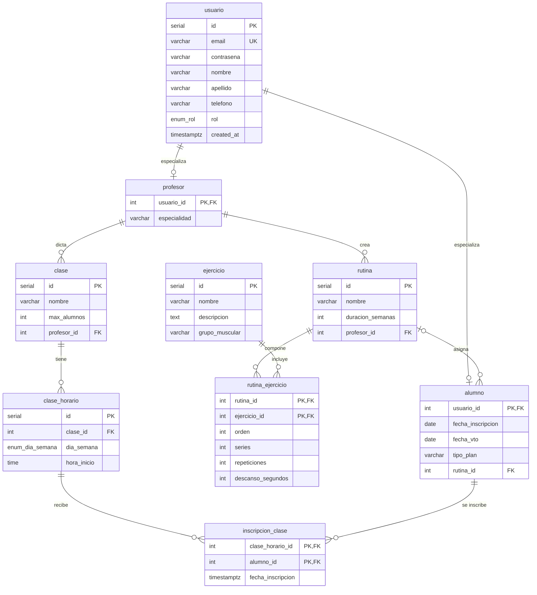

# gym-website

Página web para gimnasios. El objetivo es digitalizar las rutinas, agilizar su actualización y canalizar la inscripción a clases e información en la aplicación. A su vez, mejorar la cercanía con el cliente y su experiencia.

Esta rama (`tp5`) expone una API REST y páginas HTML renderizadas en el servidor con templ. La lógica de negocio persiste en PostgreSQL mediante sqlc. Incluye los tests de integración y `requests.hurl`.

## Cómo ejecutar

Requisitos: Go, Docker y Docker Compose. Para `make test-api`, también Hurl. Los puertos `5432` y `8080` deben estar libres.

Después de clonar, este comando prepara el proyecto, levanta la base y ejecuta la aplicación en `http://localhost:8080`:

```bash
git clone <url-del-repo>
cd <nombre-del-repo>
git checkout tp5
make run-app
```

`make run-app` hace, en orden:

1. Instala sqlc y templ si no están, genera `db/sqlc/` y las vistas con `templ generate`, y compila `main.go`
2. Borra contenedores y volúmenes previos
3. Levanta Postgres y espera a que acepte conexiones (healthcheck y una espera adicional)
4. Da de alta los usuarios de prueba con `db/seed.sql` (`make seed`)
5. Ejecuta la aplicación
6. Al salir el proceso, también con Ctrl+C, borra contenedores y volúmenes

Hacen falta Go, Docker y Docker Compose, con los puertos `5432` y `8080` libres. Si el `5432` está ocupado, hay que liberarlo: `make run-app` no usa un Postgres ajeno. Para cortar el servidor, Ctrl+C en esa terminal.

 `make test` ejecuta los tests de integración de Go. `make test-api` prueba la API y requiere Hurl.

## Persistencia

Los datos viven en **PostgreSQL 15** (`postgres:15-alpine`), definido en `docker-compose.yml`.

- Base: `tp2_db`
- Usuario / contraseña: `postgres` / `postgres`
- Puerto: `5432`
- Volumen: `postgres_data`

El esquema está en `db/migration/*.up.sql` (enums → tablas). Compose monta `./db/migration` en `/opt/sql/migration` y ejecuta `init.sh`, que aplica los `.up.sql` en orden numérico y luego `funciones.sql` y `procedure.sql`. Postgres lo corre **solo la primera vez** que se crea el volumen. Por eso el Makefile usa `docker compose down -v` antes y después: cada corrida arranca con el schema limpio.

Las consultas SQL están en `db/queries/`. `sqlc.yaml` las traduce a Go en `db/sqlc/` (paquete `db`). Ese código no se edita a mano.

Los tests se conectan con el driver `github.com/lib/pq` usando:

`host=localhost port=5432 user=postgres password=postgres dbname=tp2_db sslmode=disable`

`main.go` abre el mismo pool (o `DATABASE_URL` si está definida), hace `Ping` y pasa `*db.Queries` a los servicios. Si Postgres no está arriba, la app no arranca.

`make run-app` borra el volumen, deja que `init.sh` aplique el schema y después carga `db/seed.sql`. `make test` y `make test-api` también borran el volumen y aplican el schema, sin ese alta. `make up` y `make down` conservan `postgres_data`. Para aplicar un archivo nuevo sobre esa base: `make migrate FILE=db/migration/XXXX_nombre.up.sql`.

### Modelo

`usuario` es la identidad (email, contraseña, nombre, apellido, teléfono, `rol`). `alumno` y `profesor` la especializan 1:1 (`usuario_id` es PK y FK).

`ON DELETE CASCADE`: `usuario` borra su `alumno` o `profesor`; `rutina` borra sus filas de `rutina_ejercicio`; `clase` borra sus `clase_horario` y esas filas borran `inscripcion_clase`; `alumno` borra sus inscripciones.

Sin cascade, el `DELETE` del padre falla si hay hijos: un `ejercicio` que está en `rutina_ejercicio`, una `rutina` referenciada por `alumno.rutina_id`, y un `profesor` referenciado por `rutina.profesor_id` o `clase.profesor_id`. En la API JSON esa falla es `400`; en los formularios, `409`.



| Tabla | Qué guarda |
|---|---|
| `usuario` | Datos personales y rol (`alumno` / `profesor` / `administrador`) |
| `alumno` | Fecha de inscripción, vencimiento, tipo de plan, rutina asignada |
| `profesor` | Especialidad |
| `ejercicio` | Nombre, descripción, grupo muscular |
| `rutina` | Nombre, duración en semanas, profesor |
| `rutina_ejercicio` | Ejercicios de una rutina (orden, series, reps, descanso) |
| `clase` | Nombre, cupo, profesor |
| `clase_horario` | Día de la semana y hora |
| `inscripcion_clase` | Alumno inscripto a un horario |

Consultas en `db/queries/`: alta, lectura por id, actualización y baja de `usuario` (sin listado); CRUD de ejercicio, rutina y clase; alta, ficha, listado y actualización de profesor y de alumno. La baja de alumno y de profesor es `DeleteUsuario`. El listado de la página `/alumnos` es `ListAlumnosPagina`: orden `(nombre, apellido, id)` con `LIMIT` y `OFFSET`. `ListAlumnosCompletos` sigue ordenado por id y lo usa `GET /api/alumnos`. Horarios e inscripciones tienen alta, listado y baja. Los joins de ejercicios de una rutina, clases de un profesor y profesores de un día están en `db/queries/multitabla.sql` y en `test/`; solo el de ejercicios de una rutina tiene ruta HTTP (`GET /api/rutinas/{id}/ejercicios`).

## Tests

Paquete `test` en `test/`. Prueban la persistencia contra la base real: usuario, alumno, profesor, ejercicio, rutina, clase, inscripciones y consultas multitabla. Las de alumno cubren el orden `(nombre, apellido, id)` y la ventana `LIMIT`/`OFFSET`. También hay pruebas de páginas con `httptest` (login, roles y el listado de `/alumnos`). `make test` levanta un volumen nuevo y, al terminar, borra contenedores y volúmenes. **No** arranca el servidor HTTP; las pruebas de la API se corren por separado con `make test-api` (ver **API REST**).

## Login y roles

La app tiene tres accesos en `/login`: **profesor**, **alumno** y **administrador**. Cada uno valida que la cuenta tenga ese rol, y el resultado se ve distinto:

- **Profesor:** entra a `/alumnos`, con el menú de gestión (alumnos, ejercicios, rutinas y clases). No gestiona profesores.
- **Administrador:** entra a `/profesores`. Su menú tiene solo profesores y alumnos: da de alta, edita y borra ambos. No ve ejercicios, rutinas ni clases. El administrador no tiene tabla propia: es un `usuario` con `rol = administrador`, y no hay pantalla para crearlos (se cargan por seed o SQL).
- **Alumno:** entra a `/mi-rutina`, una vista de solo lectura con su rutina asignada y sus ejercicios. Ve únicamente la suya: el alumno sale de la sesión, no de la URL.

Cada rol queda limitado a lo suyo. Sin sesión, las páginas redirigen a `/login`; quien pide una página que no es de su rol vuelve a su propio inicio (por ejemplo, un profesor que pide `/profesores` vuelve a `/alumnos`). Un pedido HTMX sin sesión recibe `401` con `HX-Redirect: /login`.

| Método | Ruta | Qué hace |
|---|---|---|
| `GET` | `/login` | Elegir rol; con `?rol=alumno`, `?rol=profesor` o `?rol=administrador`, el formulario |
| `POST` | `/login` | Valida correo, contraseña y rol; abre la sesión y redirige |
| `POST` | `/logout` | Cierra la sesión y borra la cookie |
| `GET` | `/mi-rutina` | Rutina del alumno con sesión |

**Sesiones.** Al entrar se crea una fila en la tabla `sesion` y el navegador recibe una cookie `session` (`HttpOnly`, `SameSite=Lax`) con un token aleatorio de 256 bits. En la base solo se guarda el SHA-256 del token, así que una filtración de la tabla no sirve para entrar. Duran 24 horas fijas, sin renovación; el logout la borra al instante y al arrancar el servidor se limpian las vencidas. Las contraseñas se guardan con bcrypt (máximo 72 bytes).

La cookie lleva el flag `Secure` solo con `COOKIE_SECURE=true`. En local no hay HTTPS y el navegador la descartaría; en producción, detrás de HTTPS, debe activarse.

**La API JSON (`/api/*`) no está protegida**: es para demos con curl o Postman, y no usa sesión.

### Usuarios de prueba

El alta está en `db/seed.sql`. No es una migración: `init.sh` no lo aplica y los tests arrancan con la base vacía. Lo cargan `make run-app` (volumen nuevo, después del schema) y `make seed` (sobre la base que ya está corriendo, sin borrarla). Es idempotente: si ya existe `profe@gym.test` no repite el resto, y el administrador se agrega solo si falta.

Ese archivo da de alta un administrador, un profesor y 30 alumnos. Los 30 quedan con la rutina «Fuerza full body», que pertenece a ese profesor. Todos los alumnos comparten la misma contraseña.

| Rol | Correo | Contraseña |
|---|---|---|
| Administrador | `admin@gym.test` | `admin1234` |
| Profesor | `profe@gym.test` | `profe1234` |
| Alumno | `alumno01@gym.test` … `alumno30@gym.test` | `alumno1234` |

Para ingresar, con la app en `http://localhost:8080`:

1. Abrir `/login`.
2. Elegir **Entrar como profesor**, **alumno** o **administrador**. El rol del acceso tiene que ser el de la cuenta.
3. Completar el correo y la contraseña de la tabla.

El profesor entra a `/alumnos`. Cualquier `alumnoNN@gym.test` entra a `/mi-rutina` y ve «Fuerza full body». Son solo para desarrollo.

## API REST

Capa onion: handler HTTP → servicio → puerto. `*db.Queries` implementa los puertos. La API cubre todas las entidades del modelo.

La aplicación se abre con `make run-app`, descrito en «Cómo ejecutar», y queda en `http://localhost:8080`.

Las páginas de gestión se renderizan del lado del servidor con `templ`. `/` solo redirige según la sesión. `/alumnos` lista de a 10, ordenado por nombre, apellido e id. `/profesores`, `/ejercicios`, `/rutinas` y `/clases` muestran el listado completo, ordenado por id, y el formulario de alta. El alta y la baja usan HTMX. Editar guarda con POST y responde 303 al listado.

| Método | Ruta | Qué hace |
|---|---|---|
| `GET` | `/` | Redirige: profesor a `/alumnos`, administrador a `/profesores`, alumno a `/mi-rutina`, sin sesión a `/login` |
| `GET` | `/alumnos` | Listado de a 10, ordenado por nombre, apellido e id. Sin query: `limit=10` y `offset=0`. Otro `limit`, o un `offset` inválido o negativo, se corrige a esos valores. El título muestra el total |
| `POST` | `/alumnos` | Alta. Con HTMX: 200 y `HX-Redirect` a `/alumnos?limit=10&offset=N`, la página del nuevo. Sin HTMX: 303 a esa URL |
| `GET` | `/alumnos/{id}/editar` | Formulario de edición |
| `POST` | `/alumnos/{id}` | Guardar plan, vencimiento y rutina; 303 hacia `/alumnos` |
| `DELETE` | `/alumnos/{id}` | Baja. HTMX recibe 200 vacío y quita la fila |
| `GET` | `/profesores` | Listado y alta |
| `POST` | `/profesores` | Alta por HTMX: 200 con la fila nueva |
| `GET` | `/profesores/{id}/editar` | Formulario de edición |
| `POST` | `/profesores/{id}` | Guardar especialidad; 303 hacia `/profesores` |
| `DELETE` | `/profesores/{id}` | Baja. HTMX recibe 200 vacío y quita la fila |
| `GET` | `/ejercicios` | Listado y alta |
| `POST` | `/ejercicios` | Alta por HTMX: 200 con la fila nueva |
| `GET` | `/ejercicios/{id}/editar` | Formulario de edición |
| `POST` | `/ejercicios/{id}` | Guardar; 303 hacia `/ejercicios` |
| `DELETE` | `/ejercicios/{id}` | Baja. HTMX recibe 200 vacío y quita la fila |
| `GET` | `/rutinas` | Listado y alta |
| `POST` | `/rutinas` | Alta por HTMX: 200 con la fila nueva. Exige al menos un ejercicio |
| `GET` | `/rutinas/{id}/editar` | Edición, con ejercicios ya asociados preseleccionados |
| `POST` | `/rutinas/{id}` | Guardar atributos, profesor y ejercicios; 303 hacia `/rutinas` |
| `DELETE` | `/rutinas/{id}` | Baja. HTMX recibe 200 vacío y quita la fila |
| `GET` | `/clases` | Listado y alta |
| `POST` | `/clases` | Alta por HTMX: 200 con la fila nueva |
| `GET` | `/clases/{id}/editar` | Formulario de edición |
| `POST` | `/clases/{id}` | Guardar; 303 hacia `/clases` |
| `DELETE` | `/clases/{id}` | Baja. HTMX recibe 200 vacío y quita la fila |
| `GET` | `/static/` | Archivos de `static/` (`/static/styles.css`) |

Las cinco tablas permiten editar y borrar filas:
alumnos permite cambiar plan, vencimiento y rutina asignada; profesores,
especialidad; ejercicios, sus datos del catálogo; y rutinas/clases, sus atributos y
profesor responsable. Rutinas y clases requieren seleccionar un profesor existente;
un ejercicio que ya forma parte de una rutina no se puede borrar. Tampoco una rutina que un alumno tenga asignada, ni un profesor que todavía tenga rutinas o clases. Borrar una clase sí borra sus horarios y las inscripciones de esos horarios. Las vistas fuente
están en `views/*.templ` y el CSS se sirve desde `static/`.

El formulario de rutinas permite seleccionar varios ejercicios del catálogo. Al
editar una rutina, los ejercicios asociados aparecen preseleccionados; guardar los
cambios agrega los nuevos seleccionados y quita los desmarcados.

El nombre visible de la aplicación es **Gym Web**.

### Organización de los handlers web

Las páginas de catálogo entran por `internal/web/catalog.go`. `catalog_pages.go` arma el listado y `catalog_forms.go` el alta, la edición y la baja. Alumnos y profesores crean primero un `usuario` y después su fila; ejercicios, rutinas y clases no crean usuarios.

El alta fallida devuelve solo el mensaje del formulario, para que HTMX lo pegue sin recargar la lista. La contraseña no se conserva. La edición o la baja fallida vuelven a dibujar la página con el mensaje.

Editar abre un GET y guarda con POST, que responde 303 al listado. Borrar es `DELETE`: HTMX reemplaza la fila por la respuesta vacía. El alta de alumnos redirige a la página que le toca en el orden nombre, apellido, id. El alta de los demás catálogos devuelve la fila nueva y HTMX la agrega al final.

La API JSON de TP3 se conserva en `/api/...` para clientes existentes y para sus pruebas; la interfaz web ya no la consume desde JavaScript. Los endpoints son los mismos que se especifican en la rama `tp3`. Se dejan como ambiente de prueba: se pueden probar con curl o Postman, sin pasar por las páginas HTML.

### Prueba automática (requests.hurl)

El archivo `requests.hurl` recorre el CRUD completo de todas las entidades, casos
de error y los `DELETE`, encadenando los IDs reales que devuelve la API con las
capacidades nativas de Hurl (`[Captures]` y `[Asserts]`).

`make test-api` hace el ciclo completo: sqlc y compilación, baja contenedores y volúmenes, levanta Postgres, arranca el servidor, corre `requests.hurl`, mata el servidor y vuelve a borrar contenedores y volúmenes.

```bash
make test-api
```

Para depurar una petición con el servidor ya levantado (`make up` y `make run` en otra terminal), se puede usar `hurl --test requests.hurl`.

La URL base se define en `requests.hurl` (variable `base_url`, por defecto
`http://localhost:8080`). Como las variables de `[Options]` tienen la máxima
prioridad en Hurl, para apuntar a otro host se edita esa línea en el archivo.

### Interfaz web (SSR con templ)

La interfaz de administración se genera en el servidor con componentes `templ`.
`make build` ejecuta sqlc, genera las vistas con `templ generate` y compila el
servidor. La aplicación se abre con `make run-app`, descrito en «Cómo ejecutar», y queda en `http://localhost:8080`.

El marco está en `views/layout.templ` y carga HTMX. El listado de alumnos está en `views/alumnos_list.templ`; el de los demás catálogos, en `views/entity_list.templ`. El formulario es `views/entity_form.templ`. La interfaz permite registrar, listar, editar y eliminar alumnos, profesores, ejercicios, rutinas y clases. El alta y la baja no recargan la página. Editar sigue siendo una página completa, con POST y redirección 303. La base PostgreSQL debe estar activa.

### Ejemplos sueltos

```bash
curl -s http://localhost:8080/api/ejercicios
curl -s -X POST http://localhost:8080/api/ejercicios \
  -H 'Content-Type: application/json' \
  -d '{"nombre":"sentadilla","descripcion":"barra","grupo_muscular":"piernas"}'
curl -s -X POST http://localhost:8080/api/alumnos \
  -H 'Content-Type: application/json' \
  -d '{"email":"a@example.com","contrasena":"secret123","nombre":"Ana","apellido":"Lopez","fecha_inscripcion":"2026-09-10","tipo_plan":"mensual"}'
```

Esos `curl` pegan al servidor que dejó `make run-app`; al cortarlo se borran contenedores y volúmenes.

## Funcionalidades previstas del sistema

**Usuario profesor**

- Carga rutinas con ejercicios
- Asigna las rutinas a los alumnos
- Gestionar clases (pack de clases)
- Dashboard con métricas por persona (pesos, concurrencia, ritmos)

**Usuario alumno**

- Ve la rutina que le fue asignada
- Accede a los ejercicios (imágenes/videos)
- Ver calendario e inscribirse a una clase

En este TP la persistencia, los tests y la API cubren el modelo completo (usuario vía alumno/profesor, ejercicio, rutina, rutina_ejercicio, clase, clase_horario e inscripción).

## Requisitos / versiones

- Go `1.26.5`
- sqlc `v1.31.1`
- templ `v0.3.1100`
- PostgreSQL `15-alpine` (imagen Docker)
- Docker Compose `3.8`
- Hurl `8.0.1` (para `make test-api` / `requests.hurl`)
- `github.com/lib/pq` `v1.12.3`
- Variable `PORT` (por defecto `8080`) y `DATABASE_URL` (si no está, vale el connection string de arriba)

## Estructura de capas

- `internal/handler`: capa HTTP. Parsea JSON/URL, llama al servicio y traduce los
  errores de dominio a códigos de estado (`json.go`). No conoce SQL.
- `internal/web`: páginas HTML. Formularios, catálogos, HTMX y la página de `/alumnos`. Tampoco conoce SQL.
- `views/`: componentes templ (`layout.templ`, `alumnos_list.templ`, `entity_list.templ`, `entity_form.templ`).
- `internal/service`: lógica de negocio y validaciones. Define los tipos del
  dominio (`*_types.go`), los servicios (CRUD) y los **puertos** (`ports.go`).
- `db/sqlc`: código generado por sqlc (paquete `db`). `*db.Queries` implementa
  los puertos sin adaptador. `db/sqlc/alumno.go` y `db/sqlc/profesor.go` son
  archivos escritos a mano para el alta compuesta usuario + alumno/profesor.

Petición JSON: `internal/handler → service → puerto → *db.Queries → PostgreSQL`.

Petición HTML: `internal/web → service → puerto → *db.Queries → PostgreSQL`.

Si `make run-app` no puede publicar el puerto `5432`, ese puerto está ocupado y hay que liberarlo antes de volver a ejecutarlo.
